<a href="mailto:moazhasanfarouk@gmail.com">moazhasanfarouk@gmail.com</a> &nbsp;·&nbsp;
<a href="https://github.com/MoaazHF">GitHub</a> &nbsp;·&nbsp;
<a href="https://linkedin.com/in/moazhasan">LinkedIn</a>

  

Read as plain text

# Moaaz Hassan Farouk

Cairo, Egypt

Full-Stack Developer and Computer Science student focused on backend services, API design, and web platforms using NestJS, React, TypeScript, PostgreSQL, and Docker. Currently contributing to a Saudi food delivery platform across ordering, logistics, payments, dashboards, and operational workflows.

## Experience

**Full-Stack Developer**, RobinFood (BAHJA AL-TAUM For IT LLC), Saudi Arabia · Mar 2026 – Present

## Projects

- **Tourism Agency Platform**: React, Vite, TailwindCSS, Framer Motion. A real client project, live on Vercel, built in a 2-week sprint.
- **Task Management System**: NestJS, TypeORM, PostgreSQL, Ionic React.
- **Wassalha P2P Logistics**: React, React Router, TailwindCSS. CS systems-analysis coursework.
- **Subscription Box Platform**: Laravel, PHP, PostgreSQL, TailwindCSS. Software engineering coursework, team project.

## Training & Courses

- **ITI**: Web Development .NET, 120h, Jul 2025
- **DEPI**: React Development, 159h, Jul 2026
- **NTI AWS Academy**: Cloud Foundations + SAA, 90h, Sep 2026
- Also self-studying Backend from First Principles (YouTube), ongoing

## Skills & Abilities

- **Languages**: TypeScript, JavaScript ES6+, SQL, C
- **Frontend**: React.js, Ionic React, TailwindCSS, Ant Design, Vite, Framer Motion
- **Backend**: Node.js, NestJS, Express.js, REST & GraphQL, TypeORM
- **Data & Messaging**: PostgreSQL, Redis, RabbitMQ, BullMQ
- **Tooling**: Docker & Compose, Git & GitHub, Vercel, Postman
- **Practices**: Data Structures & Algorithms, OOP & SOLID, Software Testing, Agile
- **Working Style**: Problem-Solving, Root-Cause Analysis, System Design Trade-offs, Communication, Teamwork

## Education

**B.Sc. Computer Science**, Capital University (Helwan), Cairo, Egypt. Expected Graduation: 2028 (in progress)

## Languages & Status

Open to backend & full-stack opportunities. English: professional reading, writing & speaking.

